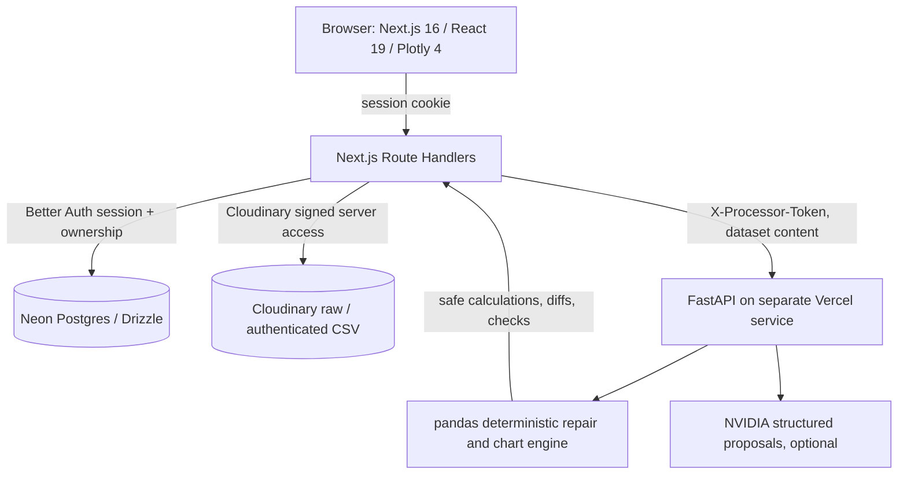

# Rowvitra — Technical Architecture

## System boundaries

The browser must never receive `PROCESSOR_SERVICE_TOKEN`, `NVIDIA_API_KEY`, Cloudinary API secret, or Better Auth signing secret. FastAPI is stateless and is not the authorization authority; Next.js enforces authenticated dataset ownership before every private processor request.

## Main data model

- Better Auth `user`, `session`, `account`, `verification`
- `datasets`: dataset ID, user ID, name, current version ID, analysis goal
- `dataset_versions`: immutable Cloudinary object key, SHA-256, cumulative approved operations, parent version
- `audit_events`: actor, action, version, evidence details, timestamp
- `saved_charts`: app-defined chart spec JSON
- `data_rules`: `not_null`, `unique`, `range`, or `allowed_values` contracts

No CSV cells are stored as database rows. Full CSV snapshots are retained in authenticated Cloudinary raw assets. Signed downloads happen server-side; a SHA-256 check rejects corrupted storage responses.

## Request flows

**Upload:** Better Auth session -> file-size and CSV extension checks -> profile with FastAPI -> Cloudinary authenticated upload -> database transaction to create dataset and original version.

**Diagnosis:** Next.js downloads the active CSV (server-side) -> FastAPI `profile` -> pandas string-preserving parse -> missing, duplicate, mixed-type, category, negative-value checks -> issue priorities based on user's goal.

**Repair:** NVIDIA or deterministic fallback proposes only whitelisted operations -> user queues proposals -> FastAPI applies to an isolated in-memory dataframe -> exact row/cell diffs, aggregate impact, data-rule checks -> user approves -> a new Cloudinary object and immutable version -> transactional compare-and-swap of `currentVersionId` to prevent stale edits.

**Visualization:** NVIDIA may provide chart-spec JSON; API validates chart type/columns/filter and pandas calculates values and stable within-version row selectors. Plotly displays data. Clicking bars or points sends selectors back to authorized processor queries to load source rows.

**Export:** CSV is the approved active snapshot. Audit JSON contains approved events and version hashes. Python script reproduces the cumulative approved recipe; the processor executes a fixed generated script against the original CSV in a bounded subprocess and rejects it unless its output exactly matches the deterministic engine result.

**Version checkpoint:** Each committed batch adds an internal `checkpoint` operation that reindexes row selectors as if the prior CSV were reloaded. This is important for replaying manual edits after row removals. Checkpoints are hidden from user-facing operation counts.

## API routes and boundaries

**Next.js:** `POST/GET /api/datasets`; `GET/PATCH /api/datasets/[datasetId]`; `POST /api/datasets/[datasetId]/process`; `POST /api/datasets/[datasetId]/restore`; `GET /api/datasets/[datasetId]/export?format=csv|python|audit`. Auth endpoints use Better Auth's `/api/auth/[...all]` route.

**FastAPI:** public `GET /health`; token-protected `/v1/profile`, `/v1/suggest`, `/v1/chart-advisor`, `/v1/preview`, `/v1/impact-chart`, `/v1/chart`, `/v1/rows`, `/v1/rules`, `/v1/replay`, `/v1/script`.

## Security limits

- 1.5 MB CSV, <=10,000 rows, <=100 columns, <=30 operations per batch, <=50 rules.
- Protected identifier-like columns cannot be bulk cast or normalized; deliberate single-cell editing requires explicit review.
- The LLM's output is not executed as code or trusted as evidence of correctness.
- Next.js validates version ID for every modification, and database compare-and-swap prevents racing commits.
- The user can restore earlier versions without modifying originals.
- Public demo processing is disabled by default and needs rate limiting if exposed publicly.
- No claim that a successful data rule or model explanation proves factual correctness of every changed value.

## Deployment

One repository, two Vercel projects. The web app root is `.` and processing service root is `services/processor/`. Database/Cloudinary credentials are required for persistent saved data. NVIDIA, Google OAuth, and email are optional; the UI must label deterministic fallbacks accurately. See `SETUP_GUIDE.md` and `TEST_REPORT.md`.

## Authentication scope decision

Email/password and optional Google OAuth are supported through Better Auth. Recovery and email verification screens were intentionally removed. The `verification` database table is kept because Better Auth can use its internal token lifecycle independently of those UI routes.

## Design and motion

Marketing uses the original sculptural imagery provided for Rowvitra and matches the screenshot's editorial composition. Shared color tokens in `app/globals.css` are augmented by `app/polish.css`. `components/landing/landing-motion.tsx` progressively enables scroll reveals. CSS disables decorative motion for `prefers-reduced-motion: reduce`.
